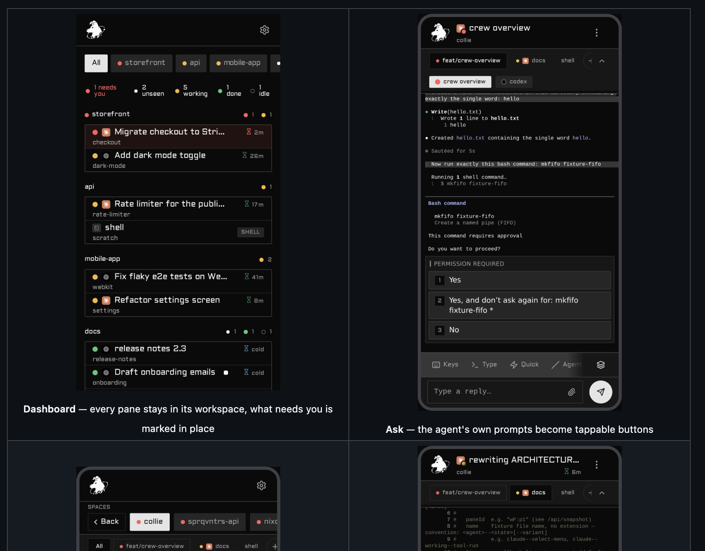
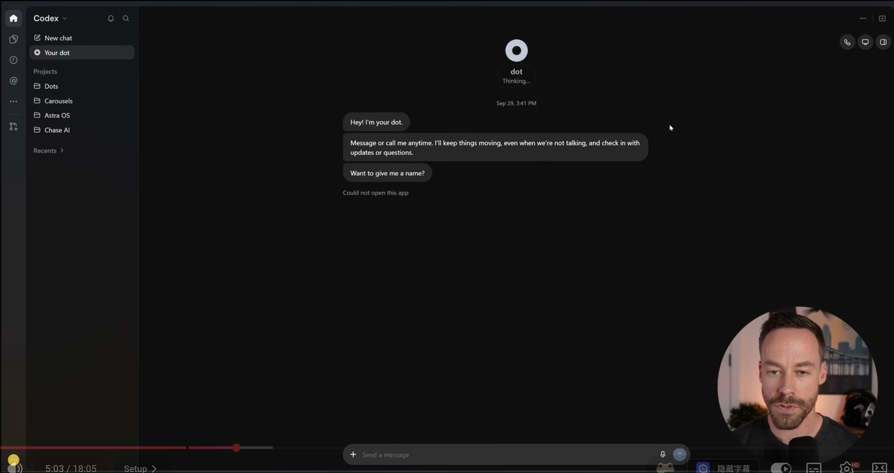
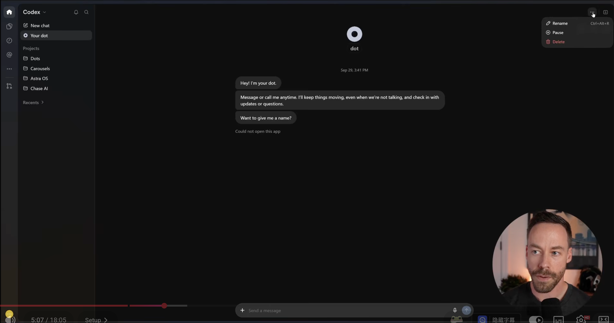
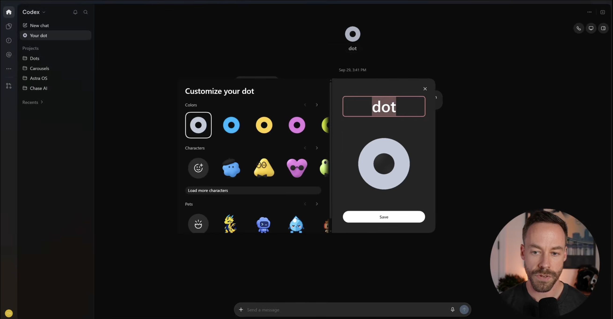
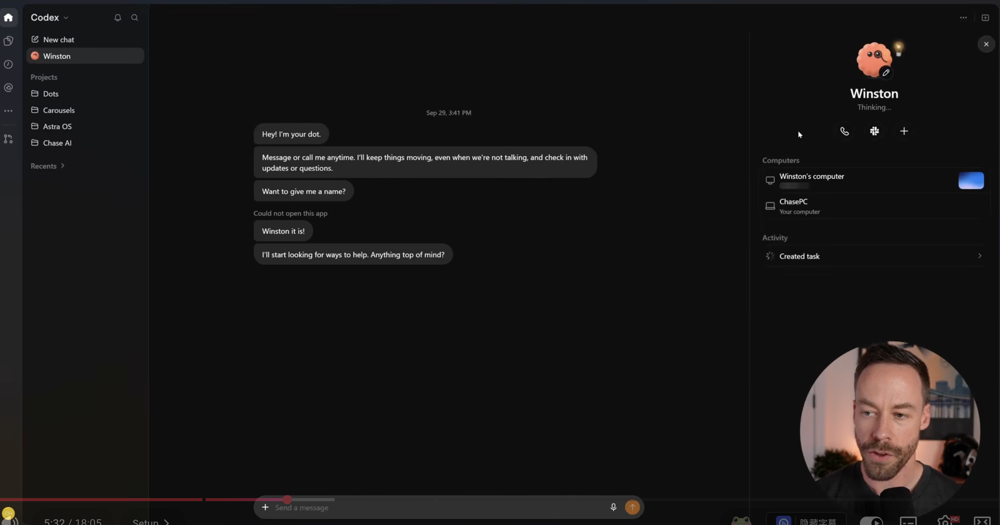
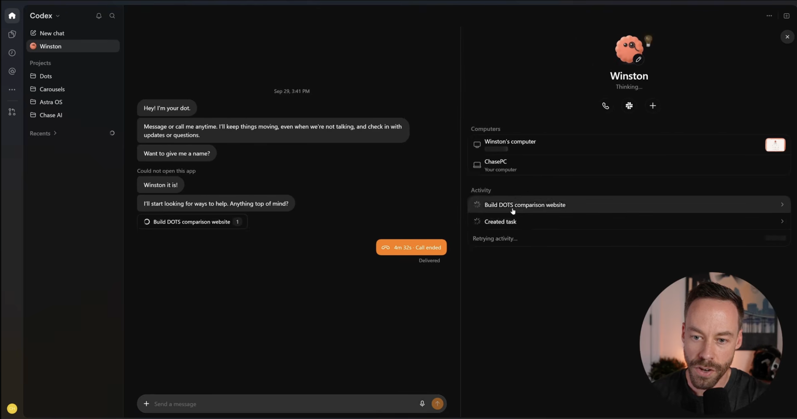
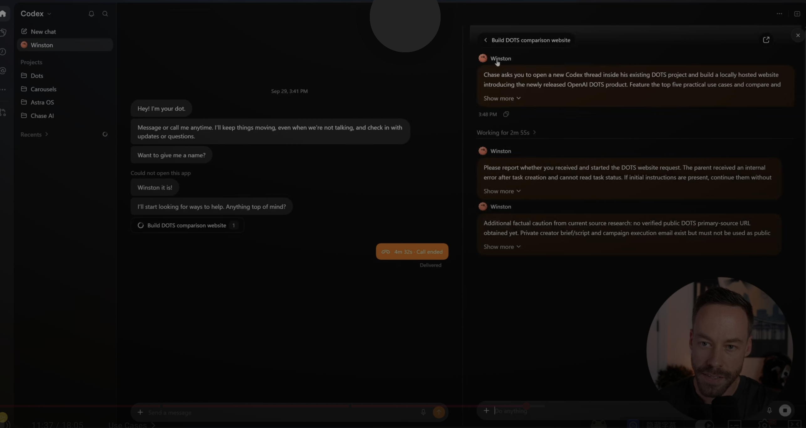
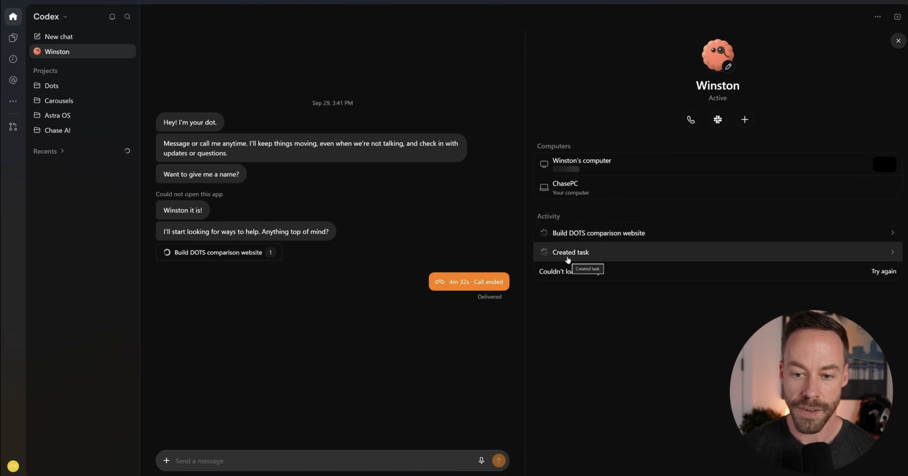
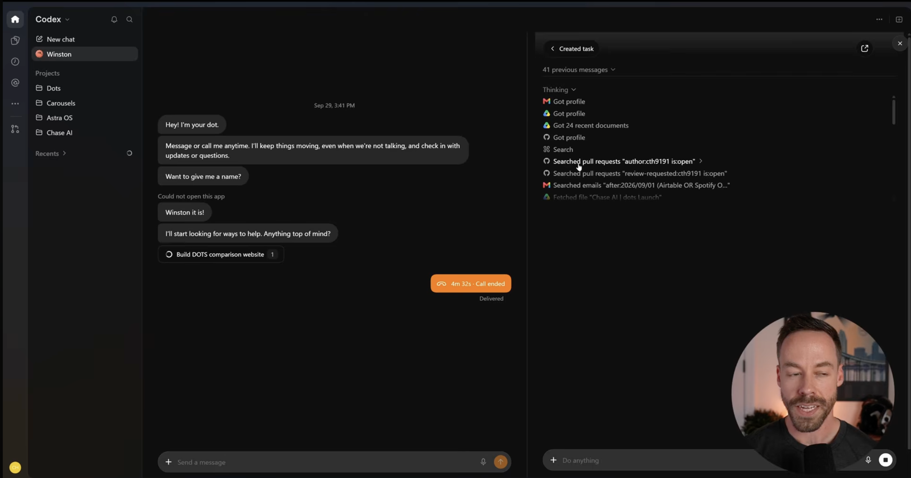
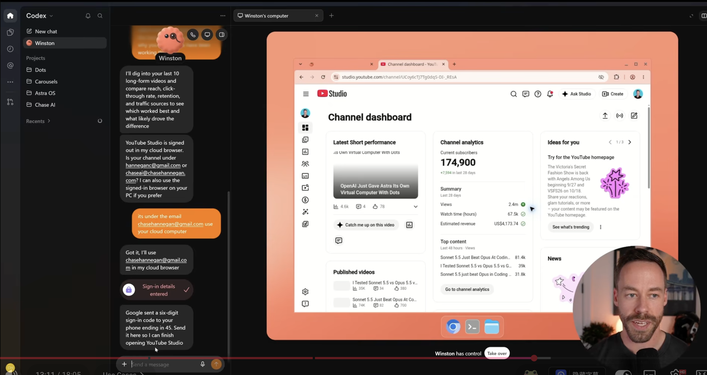

# Homeling PRD

> **Homeling** — OpenAI Dots / Grok Bot / Muse 这类 **persona agent** 的开源实现。
> 一个住在你家电脑里的、有圆头 avatar 的个人 AI 伙伴：有名字、有记忆、会主动找你；你在外面用手机 PWA 遥控它干活。
>
> 本文档是完整交接文档：阅读对象是即将在本仓库开工的 coding agent（或人类开发者）。所有产品决策、事实调研结论、视觉规格均已收敛，**按此执行即可，无需重新访谈产品决策**。
>
> 版本：v1.0 · 2026-10-03 · 状态：已评审定稿

---

## 0. 30 秒理解本项目

| 层 | 现状 | Homeling 要做的 |
|---|---|---|
| **Agent 运行时** | ✅ 已有：herdr 编排多个 agent（claude code / codex / pi 等）跑在家里的 Mac 上 | 不重做，直接用 |
| **远控管道** | ✅ 已有：Collie（herdr 插件）= 手机 PWA → Tailscale HTTPS → Bun bridge → herdr socket | 复用其 bridge 与组网，前端整目录替换 |
| **移动前端** | ⚠️ Collie 自带 PWA 是开发者向（pane 网格 + triage） | **重写**为 Dots 式消费级对话 UI |
| **Persona 层** | ❌ 不存在 | **本项目的核心新代码**：persona daemon（多人格、记忆、主动性） |

一句话：**herdr 解决了"怎么跑 agent"，Collie 解决了"怎么从手机连上"，Homeling 解决"怎么让普通人拥有一个 persona"。**

---

## 1. 背景与定位

### 1.1 对标产品

- **OpenAI Dots**（2026-09 发布，GPT-6 Astra 驱动）：ChatGPT 里的常驻个人 agent。有自己的云电脑、跨对话持续干活、主动 check-in、可定制头像/颜色/宠物。
- **Grok Bot / Meta Muse**：同代产品，共性形态 = persona（常驻人格）+ 多 persona 管理 + 任务 chip + Activity 流 + push 通知。
- **参考开源项目**：[t3code](https://github.com/pingdotgg/t3code)（24k⭐，MIT）把终端 coding agent 包装成 Codex 式消费级前端——本项目的 UI 观感标杆，但其架构（WS RPC 订阅 + Effect 事件溯源）与本项目（HTTP 轮询快照）不同，**只抄 UI 组件和数据形状，不搬 runtime**。

### 1.2 产品哲学

1. **Persona 是灵魂，不是皮肤**。Dots 三大特征：常驻人格（名字/头像/记忆）、always-on（不在对话时也在干活，做完主动找你）、有自己的电脑。前两者是本项目要新造的核心能力。
2. **普通人友好**。第一印象即产品：打开就是"我的伙伴们"的对话流，不是终端网格。
3. **不重复造轮子**。Agent 运行时用 herdr（agent 无关：claude code / codex / pi 都行），远控用 Collie bridge + Tailscale。Homeling 贡献的是 persona 编排层 + 消费级前端。

### 1.3 明确的非目标（v1）

- ❌ 实时画面共享 / Take over（Dots 最后一张截图那种屏幕接管）——Collie 无此能力，明确推迟
- ❌ 语音通话（Dots 的 call）——二期
- ❌ 自研 agent 运行时
- ❌ iOS/Android 原生 App——PWA 优先
- ❌ 推广页/完整文档——先自用，代码按开源标准写

---

## 2. 术语表

| 术语 | 含义 |
|---|---|
| **persona** | 一个常驻人格：名字、圆头 avatar、system prompt、记忆文件、绑定的项目空间。对应 Dots 的 "dot"。用户可养多个（如"工作"、"生活"各一个） |
| **persona daemon** | 本机常驻小服务（本项目核心新代码）：管理 N 个 persona 的定义/记忆/主动性，下层调 herdr 派活，上层供前端调用 |
| **herdr** | 现有 agent 编排器：workspace > tab > pane 层级，pane 里跑具体 agent（claude code/codex/pi…） |
| **Collie** | 现有 herdr 插件 `herdr.collie`：Bun bridge（`bridge/server.ts`）+ 手机 PWA，经 `tailscale serve` 暴露 |
| **space / tab / pane** | Collie 域模型三层，与 herdr 的 workspace / tab / pane 一一对应 |
| **task** | persona 创建的一次性工作 = 一个新 pane 里的 agent 会话，对话流里渲染为任务 chip |

---

## 3. 总体架构

```
┌──────────────┐   Tailscale tailnet HTTPS (禁 funnel)
│  手机 PWA     │◄──────────────────────────────────┐
│ (Homeling UI) │                                   │
└──────┬───────┘                                   │
       │ /api/* (轮询 JSON, Collie 既有契约)         │
       ▼                                           │
┌───────────────────────────────────┐              │
│  Collie bridge (Bun, 本机:8787)    │              │
│  · 静态托管 web/dist (整目录可替换) │              │
│  · /api/snapshot 轮询真相源        │──tailscale serve── 手机
│  · /api/notifications Web Push    │              │
│  · [新增] persona 扩展端点 ─────────┼──┐           │
└───────────────┬───────────────────┘  │           │
                │ herdr socket JSON-RPC│           │
                ▼                      ▼           │
        ┌──────────────┐    ┌────────────────────┐ │
        │ herdr mux    │    │ persona daemon     │ │
        │ (不动)        │    │ (新代码, 本项目核心) │ │
        └──────┬───────┘    │ · N 个 persona 定义 │ │
               │            │ · 记忆(md 文件)     │ │
        ┌──────┴───────┐    │ · 主动性/push 触发  │ │
        │ panes 跑 agent │   └────────────────────┘ │
        │ claude/codex/pi│                          │
        └──────────────┘                           │
```

**关键架构决策**：persona daemon 是独立小服务，Collie bridge 通过 additive 端点转发（或前端直连 daemon——开工时按 Collie 插件加载机制择一，倾向转发以复用鉴权）。

---

## 4. 决策记录（design tree 全量结论）

以下每条都已与产品负责人确认，**不要重新讨论**：

| # | 决策点 | 结论 |
|---|---|---|
| D1 | 换皮策略 | **重写前端**，同栈（React 19 + Vite + Tailwind + shadcn），留在 Collie 的 `web/` 目录，构建产物仍由 bridge 静态托管 |
| D2 | 目标用户 | 先自用，按开源标准写代码；不做推广页 |
| D3 | UI 组件层 | **assistant-ui**（headless `ExternalStoreRuntime` 喂轮询快照数据）+ **thinking-orbs**（思考动效，gzip 后约 15KB，移动端只放一个运行态 orb）。gpt-6.1 终审否决了"assistant-ui + AI Elements 混搭"（衔接成本 > 收益）。t3code 只抄 UI 组件与数据形状 |
| D4 | 操作范围 | Collie 功能**全集保留**（"功能要有"），但按 D8 分期；呈现方式全面 Dots 化 |
| D5 | 视觉基准 | 以 OpenAI Dots 桌面 app 截图为准（见 §8），替代 Grok 风格方案 |
| D6 | persona ↔ Collie 实体映射 | **三层对齐：persona ↔ space；project ↔ tab；thread/task ↔ pane**。tab 默认折叠为"项目"分组 |
| D7 | persona 心智模型 | persona = 前端分类 + 常驻人格；**一个 persona 专注一类任务**（如"工作"、"生活"），下面各有项目文件夹和 pane；不是单一大 persona，也不是一个 pane = 一个 persona |
| D8 | v1 范围 | v1 = 普通人必用集 + **原始终端镜像**（remote 排查刚需）；其余 power 功能（journal 跳转、changes/commit、worktree 三动词、crew 多机、launcher toml 自定义）留在旧 UI（新旧共存），二期迁移 |
| D9 | 新旧 UI 共存 | 新 UI 挂 basePath（如 `/lite`），旧 UI 保留为排查保险丝 |
| D10 | 后端改动边界 | **允许对 Collie bridge 做 additive 改动**（不改既有 API 契约，只加字段/端点）。通知摘要改造是最高杠杆。WS 二期再说，v1 以轮询为主 |
| D11 | persona 层架构 | **独立 persona daemon**（薄服务），不进 herdr 核心，不是纯前端概念 |
| D12 | 多 persona | 从第一天就是 N 个 persona（Dots/Grok Bot 均如此），persona 列表即首页 |
| D13 | agent 无关 | persona daemon 编排 herdr 的 launch/send，**不绑定 pi**；记忆注入按 agent kind 适配 |
| D14 | persona v1 能力 | (a) 持久人格（名字/头像/固定 system prompt）+ (b) 轻量记忆（markdown 记忆文件，每会话注入）+ (c) 主动性（任务完成/需审批时主动 push，复用 Collie Web Push）。语音通话二期 |
| D15 | 项目名 | **homeling**——"住在家里的一个小家伙"。终审第 1 名（npm/GitHub 无同名产品；有异业家居商标，风险可接受）。被否决的名字：boba（印象=珍珠奶茶）、opendots（商标风险+土）、tama（AI SaaS 商标申请）、nisse（撞 nisse.app 并行 agent 平台） |

---

## 5. Collie 现状事实（调研结论，开工前必读）

本地 checkout：`~/.local/share/collie/`（v1.14.2，MIT，repo: `github.com/AltanS/collie`）。协议文档：`HERDR_API.md`、`MUX_CONTRACT.md`、`ARCHITECTURE.md` §5-6。

### 5.1 架构

- 手机 PWA → **Tailscale tailnet HTTPS**（`https://<host>.tail616cc1.ts.net`，`tailscale serve` 代理 127.0.0.1:8787，明确禁用 funnel）→ Bun bridge → herdr socket JSON-RPC。
- 鉴权：`Tailscale-User-Login` header + `COLLIE_TRUSTED_USER` + Host 校验 + 同源门 + 设备配对 bearer token（`bridge/pairing.ts`）。
- 注册于 `~/.config/herdr/plugins.json`；运行配置 `~/.config/herdr/plugins/config/herdr.collie/`。

### 5.2 前端（要被替换的部分）

- `web/`：Vite + React 19 + react-router + Tailwind/shadcn PWA，产物 `web/dist` 由 bridge 静态托管（`bridge/server.ts` WEB_DIR，**支持 basePath 挂载**）。纯静态文件，无内嵌 → **可整目录替换/共存**。
- 前端↔后端仅经 `/api/*` JSON：客户端封装在 `web/src/lib/api.ts`，能力协商在 `mux-capability.ts`（`/api/config` 下发能力矩阵，unsupported 是合法响应形态）。

### 5.3 后端 API（HTTP JSON，无 WebSocket）

| 端点 | 语义 |
|---|---|
| `GET /api/snapshot` | **真相源**。一次拿全 workspace/tab/pane/agent/layout；浏览器自适应 poll，`/api/refresh` 做"戳一下"加速 |
| `POST /api/launch` | body 仅 `{command, paneId?}`；command 必须与 `launchers.toml` allowlist 精确匹配；流程 = createTab/createSpace → 等 shell 就绪 → send_text + Enter，失败自动回滚 |
| `/api/tab` `/api/workspace` `/api/folders` | 实体管理（folders = Collie 自有的最近/星标目录，仅用于选路径） |
| `GET /api/pane/:id/history` | transcript 读取（journal 历史跳转用） |
| `/api/notifications/*` | Web Push（VAPID，未配置则静默禁用）：subscribe/snooze/prefs；协调器有 debounce+cancel（快速自愈不推）、coalesce（多 agent 合并"N agents need you"）、retract（处理完撤回）；SW deep-link 到 `(host, session)` |
| `/api/config` | 能力矩阵下发 |
| `/api/pair` `/api/stt` 等 | 设备配对；语音转写（`collie stt setup` 后的内置麦克风 + hands-free） |
| `/crew/v1/*` | 联邦面（mTLS+secret），多机管理，v1 不动 |

**已知缺口（v1 要补的）**：通知正文不带 agent 的具体问题（只有"哪个 agent 在哪"，点开才见问题）→ 见 §10。

### 5.4 Collie 前端功能全集（重写时的功能清单来源）

- **普通人必用**（v1 必须全部保留，呈现方式 Dots 化）：会话 triage 首页（"N agents need you"汇总直达）、被识别提示解析成可点块（prompt-select/preview-select → 权限弹窗/选项菜单变成按钮卡片）、回复框 + 快捷回复 + 特殊键条、显式 Send + "已送达"确认、PWA + Web Push、blocked→working 卡片状态、6 locale 语言包、idle-lock、STT 语音输入。
- **power user**（v1 留在旧 UI，二期迁移）：原始 pane 镜像 + find-bar、journal 历史跳转、changes/commit 视图、发送按键/上传图片、pane 重命名/关闭/"Show in terminal"、worktree 三动词、quick-dock/Keys 托盘/launcher 行（toml 自定义）、crew 多机、设备配对吊销、update 自更新。
- **v1 提前收编**：原始 pane 镜像（原始输出查看）——remote 排查刚需（D8）。

### 5.5 Collie demo（现状观感，供对照"我们要变成什么样"）



左上：Dashboard——pane 按 space/tab 分组 + triage 状态（needs you / unseen / working / done / idle）。右上：Ask 视图——agent 的提问/权限请求变成可点按钮（PERMISSION REQUIRED → Yes / Yes-and-don't-ask / No）。左下：SPACES 切换器。这些**交互能力全部保留**，但视觉与 IA 重排成 Dots 式。

---

## 6. persona daemon 设计（本项目核心新代码）

### 6.1 职责

```
persona daemon
├── Persona Registry    # N 个 persona 的定义：{id, name, avatar(颜色/字符/小宠物), systemPrompt, spaceId, agentKind}
├── Memory Store        # 每 persona 一个 markdown 记忆文件目录（facts.md, preferences.md, projects/<space>.md …）
├── Memory Injection    # launch/发消息时把记忆注入上下文；按 agent kind 适配（各 agent 注入方式不同）
├── Activity Ledger     # persona 的活动流（task 创建/完成/失败）→ 前端 Activity 面板 + push 触发
├── Proactivity         # 事件→动作：task 完成/失败/需审批 → Web Push（复用 Collie notifications 管道）；"定期 check-in"二期
└── HTTP API (additive) # /api/persona/* 系列，经 Collie bridge 转发以复用鉴权
```

### 6.2 persona API 草案（additive，不破坏 Collie 既有契约）

```
GET    /api/persona/list              # 全部 persona + 状态(thinking/active/idle/blocked)
POST   /api/persona/create            # {name, avatar, systemPrompt, agentKind?}
PATCH  /api/persona/:id               # 改名/头像/prompt（对应 Dots 的 Rename/Customize）
POST   /api/persona/:id/message       # 向 persona 发消息 → daemon 选择其当前 thread 或新开 pane
POST   /api/persona/:id/task          # 派新任务（新 pane）——"New chat"/任务 chip 的后端
GET    /api/persona/:id/memory        # 记忆文件读取（前端可展示/编辑）
PUT    /api/persona/:id/memory/:file
GET    /api/persona/:id/activity      # Activity 流（对应 Dots 右侧面板）
POST   /api/persona/:id/pause         # 对应 Dots 的 Pause
```

### 6.3 与 herdr 的映射

- persona ↔ **space**（创建 persona = createSpace）
- project ↔ **tab**（persona 详情页里的"项目"分组，默认折叠）
- task/thread ↔ **pane**（`/api/launch` 按 `launchers.toml` allowlist 启动，daemon 负责 pick 对应 agent kind 的 launcher 行）
- 记忆注入：launch 时随首条消息携带 persona system prompt + 记忆摘要；对支持系统级配置的 agent kind（如 pi 的 agent 定义）走其原生机制，其余走首条消息前缀。**daemon 不假设所有 agent 是同一种**。

---

## 7. 前端设计

### 7.1 技术栈与组件层

- React 19 + Vite + react-router + Tailwind + shadcn（与 Collie `web/` 同栈，构建产物直接进 `web/dist` 或 basePath 目录）。
- **assistant-ui**：`ExternalStoreRuntime` 直喂 Collie 轮询快照映射出的消息数组。适配要点：稳定 message/tool ID、不可变替换、映射 status/isRunning；审批 POST、乐观状态、旧快照防回滚需自写。原生覆盖：流式、tool-call/审批 UI、markdown 代码块；任务 chip 用 `makeAssistantToolUI` 自定义。
- **thinking-orbs**（libraries.dev/orbs，MIT，0.3.2，零运行时依赖）：persona "Thinking..." 状态动效。注意：移动端只放一个运行态 orb；Canvas 已支持减弱动效/离屏暂停。
- **t3code**（MIT）：只参考其消息流/审批卡片/工具调用折叠的**组件与数据形状**，不搬 client-runtime（其 WS RPC 订阅架构与本项目轮询快照错位）。

### 7.2 信息架构（IA）

```
底部 Tab 栏（手机）:
┌────────────────────────────────────────────┐
│  🏠 Homelings   ＋新建   🔔   ⚙️ 设置        │
└────────────────────────────────────────────┘

① Homelings 首页（= Dots 侧栏的手机化）
   · triage 汇总条："2 个伙伴需要你"（复用 Collie 的 needs-you 统计）
   · persona 卡片列表：圆头 avatar + 名字 + 状态(Thinking…/Active/Blocked·需你) + 最近一句
   · 下拉 = 新建 persona

② Persona 对话页（主界面，对标 dots-01/04/05）
   · 顶部：avatar + 名字 + 状态 + ⋯菜单(Rename/Pause/原始输出)
   · 消息流：气泡对话；任务 chip 内嵌（"▶ Build xxx · working"）；权限请求 = 按钮卡片（Collie prompt-select 能力）；工具调用 = 可折叠行
   · 底部：+ 附件 / 输入框 / 🎤 STT / 发送（显式 Send + 已送达确认）
   · 右滑/ⓘ → Persona 面板：大 avatar、状态、按钮组（call 二期/新建任务）、
     Computers（本机）、Activity 流（task 列表 → 点开任务详情）

③ 任务详情页（对标 dots-06/07）
   · 任务 chip 展开为全屏：子 agent 消息流 + "Working for Xm" + Thinking/工具调用 trace 折叠
   · 底部"Do anything"输入 + 停止按钮；原始 pane 镜像入口（v1 收编）

④ 设置 / 配对 / 通知偏好：复用 Collie 既有能力
```

**旧 UI 共存**：新 UI 挂 basePath（如 `/lite`），旧入口保留（D9）。

---

## 8. 视觉规格（基准：Dots 桌面 app 截图）

### 8.1 主对话界面



- **配色**：近黑背景（#1a1a1a 级），无重色；一个品牌强调色用于发送按钮/活动 pill（Dots 用橙）；消息气泡深灰（#2a2a2a 级）大圆角。
- **布局**：居中窄栏对话流（手机上即全宽）；顶部 persona 圆头 avatar + 名字 + "Thinking..." 状态（此状态用 thinking-orbs 动效）；底部悬浮输入条（+ 附件 / 文本 / 🎤 / ↑发送）。
- **侧栏**（桌面宽屏时显示，手机收纳进底部 tab）：New chat、persona 列表、Projects 分组（D6：tab 折叠成项目）、Recents。

### 8.2 persona 菜单与定制




- ⋯菜单：Rename / Pause / Delete（Homeling 增加"原始输出"入口）。
- Customize：Colors（圆点色板）+ Characters（圆头小怪脸）+ Pets + 改名。**avatar 体系 = 圆头小球 + 可选表情/颜色/小宠物**，persona daemon 存 `{color, character, pet}`。

### 8.3 Persona 面板与 Activity



- 右侧面板（手机 = 侧滑抽屉）：大 avatar + 名字 + 状态 + 按钮组；**Computers** 列表（本机 + "Your computer" 标注）；**Activity** 流：每行 = 任务（"Build DOTS comparison website"）/事件（"Created task"），点击进任务详情。

### 8.4 任务 chip 与通话 pill



- 对话流内嵌任务 chip：`○/◍ Build xxx website · [计数]`，点击展开任务详情。
- （二期参考）语音通话结束显示橙色 pill "4m 32s · Call ended"。

### 8.5 任务详情（子 agent 视角）




- 任务详情 = 以"子 agent 消息"形式展示任务的执行对话；"Working for 2m 55s" 运行时长头部；Show more 折叠长消息。
- Thinking trace：工具调用逐行渲染（图标区分 Gmail/Drive/GitHub/搜索等来源 + 动作描述），全部可折叠。**Homeling 的对应物 = Collie pane history 的渲染**，保留原始输出入口。
- 底部独立输入框（"Do anything"）+ 停止按钮——对任务的后续指令是对话，不是新任务。

### 8.6 实时画面（明确推迟）




- Dots 的 "Winston has control / Take over" 屏幕共享/接管。**Collie 无此能力，v1/v2 不做**，仅作远期参考。

---

## 9. v1 功能清单（验收基线）

**In（全部必须有）**：

1. 多 persona：创建/改名/换头像（色+脸+宠物）/暂停/删除
2. Persona 对话流：气泡、流式刷新（轮询驱动）、markdown、工具调用折叠、任务 chip
3. 权限/选项请求 → 可点按钮卡片（Collie prompt-select/preview-select 能力的 Dots 化）
4. 派新任务（= launch 新 pane，经 `launchers.toml` allowlist）
5. 任务详情页（子 agent 消息 + 运行时长 + trace + 后续指令 + 停止）
6. Activity 流 + Computers 面板
7. Web Push：任务完成/失败/需审批，**正文带具体问题摘要**（§10）
8. triage 首页（"N 个伙伴需要你"）
9. 记忆：markdown 记忆文件 + 会话注入 + 前端可查看/编辑
10. STT 语音输入、快捷回复、特殊键条、显式 Send + 已送达
11. 原始 pane 镜像入口（排查用）
12. PWA：安装、 basePath `/lite` 共存、设备配对、idle-lock、6 locale 沿用
13. thinking-orbs 思考动效

**Out（v1 明确不做）**：实时画面/Take over、语音通话、定期自主 check-in、crew 多机前端、changes/worktree/journal 高级视图（旧 UI 保留）、WS 实时推送。

---

## 10. Collie bridge additive 改动清单

不改既有端点契约，只加：

1. **通知摘要**：push 正文携带 agent 当前问题的具体摘要（bridge 侧从 pane 最近 transcript 提炼首行/选项文本）。现状正文只有"哪个 agent 在哪"——这是普通人友好最大杠杆。
2. **persona 端点转发**：bridge → persona daemon 的反代（复用 Tailscale 鉴权/同源门/配对 token，daemon 自身只听 localhost）。
3. （可选，实测轮询体验后再定）`/api/refresh` 的服务端合并节流微调。

---

## 11. 里程碑与验收

| 里程碑 | 内容 | 验收标准 |
|---|---|---|
| **M0 骨架** | 仓库初始化；Collie checkout 内新前端 `/lite` 挂载跑通；`/api/snapshot` 快照映射到 assistant-ui ExternalStore 的最小消息流 | 手机经 Tailscale 打开 `/lite`，看到现有 pane 的对话流 |
| **M1 对话即界面** | persona 空间映射（persona↔space）、气泡流、任务 chip、权限按钮卡片、STT、发送确认 | 全程手机完成一轮"派活→审批→收结果"，不碰旧 UI |
| **M2 persona daemon** | daemon 服务 + persona CRUD + 记忆注入 + Activity 流 + persona 面板 | 重启后 persona 与记忆仍在；两个 persona 各自独立工作 |
| **M3 主动性** | 通知摘要改造 + 完成/失败/需审批 push + triage 首页 | 锁屏收到"需要你批准 mkfifo fixture-fifo"级别摘要 |
| **M4 打磨** | Customize avatar、thinking-orbs、动效、locale、开源化（README/LICENSE/CI） | 自用一周无回退旧 UI 的记录 |

---

## 12. 风险与开放问题（开工时注意，非产品决策）

1. **轮询流式感**：无 WS，流式输出靠自适应 poll + `/api/refresh` 戳。M1 先实测；不丝滑再评估 additive WS（D10 留了口子）。
2. **launchers.toml allowlist**：persona 派任务只能启 allowlist 内命令；需要为常见 agent kind（claude/codex/pi）预置合理 launcher 行。
3. **记忆注入的 agent 差异**：各 agent kind 注入系统上下文方式不同，daemon 的注入器按 kind 策略化，M2 先支持一种（建议 pi），其余降级为首条消息前缀。
4. **homeling 商标**：npm/GitHub 可用，但存在异业（家居）商标；开源非商业使用风险低，若商业化前需清查。
5. **Collie 上游演进**：bridge 是 additive 改动，升级 Collie 时注意 rebase；考虑给上游提 PR。

---

## 13. 参考索引

| 资源 | 位置/链接 |
|---|---|
| Collie 本地 checkout | `~/.local/share/collie/`（协议文档 `HERDR_API.md` / `MUX_CONTRACT.md` / `ARCHITECTURE.md`） |
| Collie repo / demo | github.com/AltanS/collie · colliepwa.dev/demo |
| herdr | 本机已安装；插件注册 `~/.config/herdr/plugins.json` |
| t3code（UI 参考标杆） | github.com/pingdotgg/t3code（MIT，24k⭐） |
| assistant-ui | github.com/Yonom/assistant-ui（MIT，12.4k⭐）· ExternalStoreRuntime 文档 |
| thinking-orbs | libraries.dev/orbs · github.com/Jakubantalik/Libraries.dev（packages/thinking-orbs，MIT） |
| Vercel AI Elements（落选备查） | vercel/ai-elements（Apache-2.0，有 Confirmation 组件） |
| OpenAI Dots 原始参考 | openai.com/index/introducing-dots（截图见 assets/） |

## 附录：assets 清单

| 文件 | 内容 |
|---|---|
| `assets/dots-01-chat-main.png` | Dots 主对话：侧栏 IA + 圆头 avatar + Thinking 状态 + 气泡流 + 输入条 |
| `assets/dots-02-dot-menu.png` | persona ⋯菜单：Rename / Pause / Delete |
| `assets/dots-03-customize-dot.png` | Customize：Colors / Characters / Pets + 改名 |
| `assets/dots-04-persona-panel.png` | Persona 面板：大 avatar + Computers + Activity |
| `assets/dots-05-task-chip.png` | 任务 chip 内嵌对话流 + Activity 任务行 |
| `assets/dots-06-task-detail.png` | 任务详情：子 agent 消息 + Working 时长 |
| `assets/dots-07-task-trace.png` | Thinking/工具调用 trace 逐行渲染 |
| `assets/dots-08-screen-view.png` / `dots-09` | 实时画面/Take over（**推迟**） |
| `assets/collie-demo-current.png` | Collie 现状：Dashboard triage + Ask 权限按钮 + Spaces |
