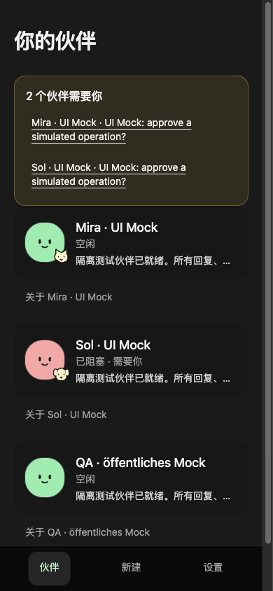
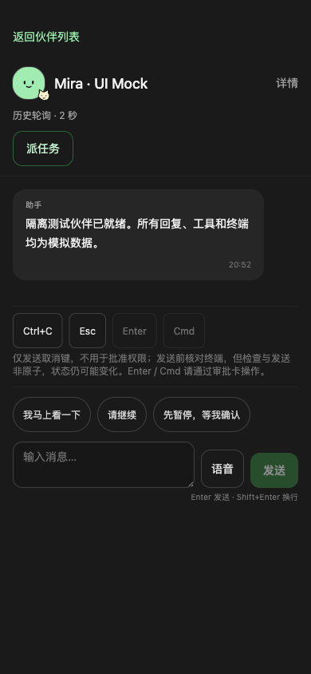
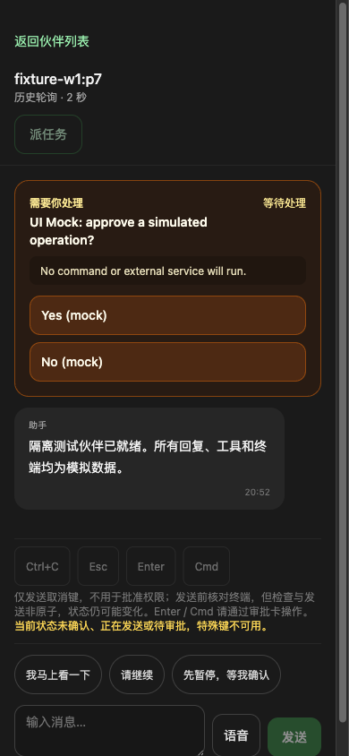

<div align="center">

# Homeling

住在自己电脑上的 AI 伙伴。

在手机上对话、派任务、处理审批，查看伙伴正在做什么。

[](https://github.com/toRolex/homeling/actions/workflows/ci.yml)
[](LICENSE)

[界面预览](#界面预览) · [开始开发](#开始开发) · [部署文档](docs/deployment.md) · [开发进度](https://github.com/toRolex/homeling/issues/1)

</div>

> 当前为开发预览版。真实 agent 工作流程与手机通知仍在完善，进度见 [Spec #1](https://github.com/toRolex/homeling/issues/1)。

## 界面预览

伙伴首页、对话与任务审批。截图使用模拟数据。

<table>
  <tr>
    <th>你的伙伴</th>
    <th>对话与快捷回复</th>
    <th>处理审批</th>
  </tr>
  <tr>
    <td></td>
    <td></td>
    <td></td>
  </tr>
</table>

## Homeling 做什么

Homeling 是 Dots / Grok Bot / Muse 这类 persona agent 的开源实现。每个伙伴有自己的对话、记忆和任务。移动界面把消息、审批和运行状态放在一起，方便离开电脑时查看。

| 界面与功能 | 已有实现 |
| --- | --- |
| 伙伴 | 创建与导航、头像定制、运行状态、待处理请求汇总 |
| 对话 | 消息流、快捷回复、送达对账、权限请求卡片 |
| 任务 | 派任务入口、任务详情、工具 trace、只读终端镜像 |
| 记忆 | Markdown 编辑、版本冲突检查、会话启动时注入 |
| 日常使用 | Activity、六语言界面、服务端 idle-lock |
| 手机访问 | PWA、独立 Web Push、通知去重与合并 |

各功能的使用说明见[部署文档](docs/deployment.md)。

### 仍在开发

- 任务启动结果的持久记录与超时后的清理确认。
- 控制键接收端的原子校验及 Cmd 语义。
- 记忆注入与真实 pi history 的精确对应。
- 通知请求代际与断连后的事件恢复。
- Homeling 自持 runtime/history 路径。

真实 pi、STT、手机 HTTPS、PWA 安装与锁屏通知待验收。剩余工作在 [Issues](https://github.com/toRolex/homeling/issues) 中跟踪。

## 开始开发

安装 Bun 后，在仓库根目录执行：

```bash
bun install --frozen-lockfile
bun run typecheck
bun test
bun run build
```

本地开发使用两个终端：

```bash
bun run dev:daemon
```

```bash
bun run dev:web
```

开发界面需要配置后端，Vite 的开发代理直连 bridge。手机部署使用 daemon 的 `/lite/` 入口。

### 自部署前先阅读

现有部署使用 macOS、Bun、Collie / Herdr 和 Tailscale HTTPS。Homeling 自持 runtime 正在开发。

[部署文档](docs/deployment.md)包含前置检查、身份配置、安装、更新与排障。下面列出常用命令，按文档中的步骤使用。

<details>
<summary>部署命令索引</summary>

安装与构建：

```bash
bash scripts/install-launchd.sh
bash scripts/build-web.sh
```

检查安装不变量：

```bash
bash scripts/canary.sh save
bash scripts/canary.sh check
```

仅添加或移除 Homeling 的路径，保留现有根 handler：

```bash
tailscale serve --bg --https=443 --set-path=/lite/ 8790
tailscale serve --https=443 --set-path=/lite/ off
```

</details>

## 架构

现有实现使用 Bun + TypeScript daemon 托管 React / Vite 前端。daemon 自持 registry、记忆、Activity、鉴权和通知，并通过窄路由访问本机 legacy Collie bridge。Herdr 管理运行中的 agent panes。

```text
手机浏览器
  │ Tailscale HTTPS
  ├─ /       → 现有 Collie bridge :8787
  └─ /lite/  → Homeling daemon :8790
                 ├─ React 前端
                 ├─ registry / memory / Activity / push
                 └─ legacy bridge → Herdr agent panes
```

Homeling 独立安装，保留现有 Collie。daemon 只监听 loopback，通过 Tailscale 身份与 Host / Origin 检查控制远程访问。对话内容会发送给所选模型 provider。

## 文档与贡献

- [部署与使用](docs/deployment.md)：环境配置、功能限制和排障。
- [产品需求](PRD.md)：v1 的功能与验收要求。
- [领域术语](GLOSSARY.md)与[架构决策](docs/adr/)：实体和设计约束。
- [Issues](https://github.com/toRolex/homeling/issues)：剩余实现、验收与问题反馈。

开发前先读对应工单，修改后运行类型检查、测试和构建。截图请使用模拟数据，不提交真实对话、凭据、tailnet 信息或 push 私钥。

## 许可证

[MIT](LICENSE)
